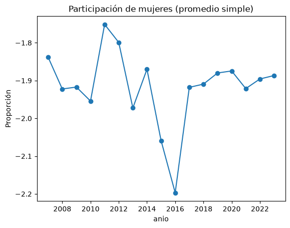

# Participación de mujeres en el empleo registrado en Argentina (2007-2023)

Práctica de análisis de datos con Python (pandas, NumPy y Matplotlib) sobre la proporción de mujeres en el empleo registrado, por fecha, provincia y sector de actividad.

## Datos

- **Fuente:** [datos.gob.ar, porcentaje de mujeres por provincia y sector de actividad](https://datos.gob.ar/dataset/porcentaje-de-mujeres-por-provincia-y-sector-de-actividad). Revisá allí la licencia de uso.
- **Tamaño:** 390.978 filas, con datos mensuales de enero de 2007 a noviembre de 2023.
- **Calidad:** no tiene valores vacíos.
- **Columnas:**
  - `fecha`: mes de la observación.
  - `zona_prov`: provincia o zona.
  - `clae2`: código de actividad económica a dos dígitos (es una categoría, no una cantidad).
  - `share_mujer`: proporción de mujeres, de 0 a 1 (por ejemplo, 0,25 equivale a 25 %).

## Contenido del proyecto

- `probar_entorno.ipynb`: cuaderno con el análisis paso a paso.
- `datos/share_mujer_prod.csv`: datos de entrada.
- `grafico_anual.png`: gráfico generado por el cuaderno.
- `requirements.txt`: librerías necesarias.

## Cómo correrlo (Windows, PowerShell)

```powershell
py -m venv venv
.\venv\Scripts\Activate.ps1
pip install -r requirements.txt
```

Después abrí `probar_entorno.ipynb` en VS Code, elegí como kernel el intérprete de `venv` y ejecutá las celdas en orden. El cuaderno espera que la carpeta de trabajo sea la raíz del proyecto, porque usa rutas relativas.

Si PowerShell bloquea la activación, corré una vez `Set-ExecutionPolicy -Scope CurrentUser RemoteSigned`.

## Qué hace el análisis

1. **Cargar:** lee el CSV con `pd.read_csv()`.
2. **Revisar:** `head()`, `info()` e `isna().sum()` para ver el contenido, los tipos y los vacíos.
3. **Preparar:** convierte `fecha` a tipo fecha, `clae2` a categoría y obtiene el año.
4. **Analizar:** calcula el promedio anual de `share_mujer` con `groupby`.
5. **Comunicar:** grafica la serie con Matplotlib y la guarda en `grafico_anual.png`.

## Resultados

Pendiente: completar con los valores que muestre el gráfico (por ejemplo, entre qué valores se movió la participación y en qué años cambió más).



## Limitaciones

- El promedio es **simple**: trata igual a una actividad chica que a una grande, porque la tabla no trae cantidad de personas empleadas para ponderar.
- Un promedio anual describe la tendencia general, pero no explica por sí solo las diferencias entre provincias o sectores.
- No se interpretó el código `999` de `clae2`: falta confirmar en la documentación de la fuente qué representa.

## Próximos pasos

- [x] Lectura y revisión de los datos
- [x] Evolución anual
- [ ] Comparación entre provincias
- [ ] Comparación entre sectores de actividad
- [ ] Ponderar o interpretar con información de cantidad de trabajadores, si se consigue